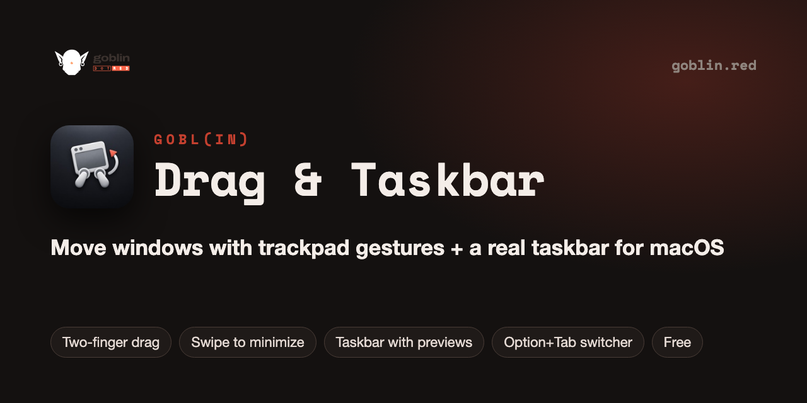
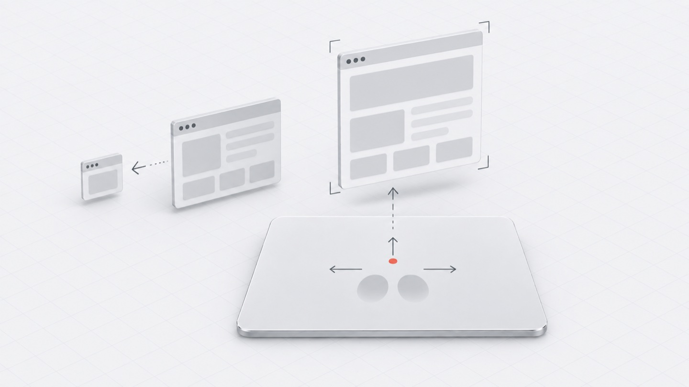

<p align="center"></p>

# GOBL(in) Drag & Taskbar — trackpad window gestures, a taskbar and Alt-Tab for macOS

   [](LICENSE) [](https://github.com/goblin-red/Drag-and-Taskbar/stargazers)

**Stop hunting for the title bar.** Hold a modifier key and drag any window from anywhere with two fingers on the trackpad, swipe to minimize, maximize or close it, see every open window in a Windows-style taskbar with previews, and switch windows with Option+Tab (an Alt-Tab for Mac that includes minimized windows). A free, native menu bar app.

<p align="center"></p>

Move, minimize and switch windows with trackpad gestures. Hold a modifier key and the window under
the cursor follows your finger, wherever you "grab" it. No more aiming for the title bar.
On the [GOBL(in)](https://goblin.red) website it is listed as two items, Drag and Taskbar; it is one app.
A Windows prototype is
in the works and is not published yet.

- **Drag without the title bar**: three modes. The window follows the cursor while the modifier is held,
  follows a two-finger trackpad gesture, or follows the mouse while the modifier and the right button are held.
- **Swipes**: with the modifier held, a two-finger swipe left or right minimizes or closes the window under
  the cursor (you choose which); swipe up maximizes it, swipe down restores the size and leaves full screen.
- **Focus follows**: make the window under the cursor active by pressing the modifier or moving the mouse with it.
- **App switcher**: Option+Tab shows every window of every running app, minimized ones included.
- **Resize**: Control + two-finger swipe (turn it on in the settings).
- **Hold Shift** to cancel a drag.
- **Menu bar app**: no Dock icon, starts at login if you want, settings change on the fly.

## Requirements

- macOS 13 Ventura or newer
- Xcode Command Line Tools (`xcode-select --install`), the build uses `swiftc` directly

## Install

Paste this into Terminal:

```sh
curl -fsSL https://raw.githubusercontent.com/goblin-red/Drag-and-Taskbar/main/install.sh | bash
```

The script downloads the ready-made build from [Releases](https://github.com/goblin-red/Drag-and-Taskbar/releases/latest),
puts it into `/Applications/GOBL(in) Drag & Taskbar` and opens it. The build is universal: it runs on Apple Silicon and on Intel Macs,
and no Xcode tools are needed. Then allow the app once, see [Permission](#permission). Your `config.txt` is kept between updates. To update, run the same command again.

Downloaded the zip by hand? The app is not notarized by Apple, so macOS blocks a downloaded copy.
Unblock it once:

```sh
xattr -dr com.apple.quarantine "/path/to/GOBL(in) Drag & Taskbar"
```

## Build from source

```sh
git clone https://github.com/goblin-red/Drag-and-Taskbar.git
cd Drag-and-Taskbar

./create-cert.sh        # once: a local signing certificate, so the permission survives rebuilds
./build.sh              # universal: Apple Silicon + Intel (default)
open "GOBL(in) Drag & Taskbar.app"
```

Build modes:

| Command | Builds |
| --- | --- |
| `./build.sh` | arm64 + x86_64 in one binary, runs on any Mac (default) |
| `./build.sh arm` | arm64, Apple Silicon only |
| `./build.sh intel` | x86_64, Intel Macs only |

## Permission

The app needs **Accessibility** access: *System Settings → Privacy & Security → Accessibility* →
turn on `GOBL(in) Drag & Taskbar`. Without it macOS doesn't let the app see gestures or move windows.
With the certificate from `create-cert.sh` the permission is kept between rebuilds.

## How to use (default modifier: ⌥ Option)

| Action | What it does |
| --- | --- |
| ⌥ + move the cursor | the window under the cursor follows |
| ⌥ + two-finger swipe left / right | minimize (or close) the window |
| ⌥ + two-finger swipe up / down | maximize / restore the window |
| ⌥ + Tab | window switcher with all windows |
| Shift while dragging | cancel the drag |
| Control + two-finger swipe | resize the window (enable in settings) |

## Settings

Open the menu bar icon → **Settings…**. Every option is also stored in a plain text file `config.txt`
next to the app, with a comment for each line. It is created with the default values on the first run;
`default-config.txt` keeps a copy of those defaults.

## Project

| Path | Purpose |
| --- | --- |
| `Sources/TwoFingerDrag/App.swift` | the app and the menu bar icon |
| `Sources/TwoFingerDrag/DragController.swift` | event tap, gestures and window moves |
| `Sources/TwoFingerDrag/Windowing/` | Accessibility API helpers |
| `Sources/TwoFingerDrag/AppSwitcher/` | the window switcher |
| `Sources/TwoFingerDrag/Settings/`, `UI/` | settings, config file and the settings window |
| `build.sh`, `create-cert.sh` | build and local code signing |
| `install.sh` | installs the ready-made build from Releases |
| `package.sh` | packs the build for Releases: `dist/goblin-drag-macos.zip` |
| `logo.svg`, `AppIcon.icns` | the Goblin logo for the menu and the app icon |
| `AGENTS.md` | full technical documentation and critical rules |
| `CHANGELOG.md` | change history |

## FAQ

**How do I move a window on a Mac without grabbing the title bar?**
Hold the modifier key (Option by default) and move two fingers on the trackpad — the window under the cursor follows. You can also drag with the mouse while holding the modifier.

**Is there a Windows-like taskbar for macOS?**
Yes — the Taskbar option shows every open window as a button along the bottom of the screen, with hover previews and quick access to minimized windows.

**Is there an Alt-Tab for Mac that switches windows, not apps?**
Option+Tab opens a switcher with every window of every running app, minimized ones included.

## More GOBL(in) apps

Free and open source, from the makers of [GOBL(in)](https://goblin.red):

| App | What it does |
| --- | --- |
| [GOBL(in) Remote](https://github.com/goblin-red/Goblin-Remote) | self-hosted remote desktop for macOS in any browser, over cheap PHP hosting |
| [GOBL(in) Voice](https://github.com/goblin-red/Orca-Voice) | voice control and dictation for Claude Code, Codex and Orca on macOS |
| [GOBL(in) Session Viewer](https://github.com/goblin-red/Session-Viewer) | every Claude Code, Codex, Grok and OpenCode session in one window |
| [GOBL(in) Convert](https://github.com/goblin-red/Photo-Convert) | fast batch JPEG converter and photo resizer for macOS |
| [GOBL(in) Workflow](https://github.com/goblin-red/Workflow) | visual flowchart workflows run by AI coding agents |

If this project is useful to you, please ⭐ star it — it helps other people find it.


## License

[MIT](LICENSE)
